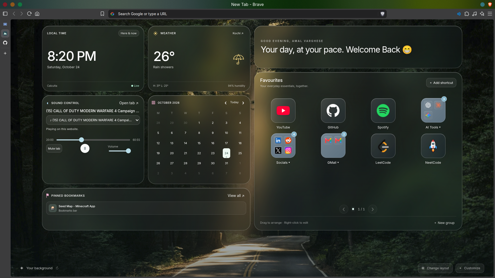
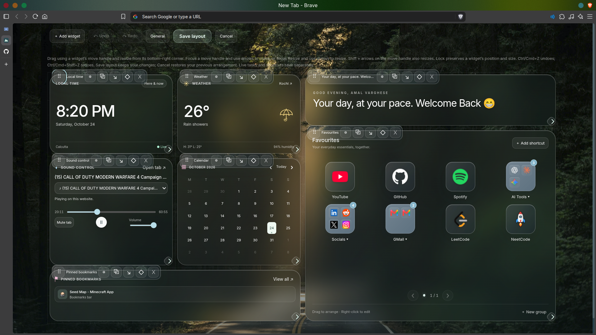
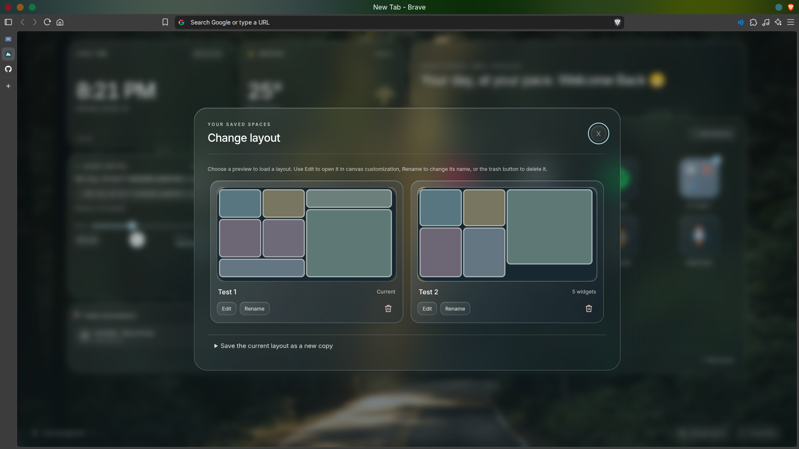

# TabTahoe

A macOS-inspired new tab extension for Brave and Chromium based browsers. Frosted glass, nature wallpapers, and everyday essentials in one quiet dashboard.

TabTahoe supports PC/desktop browsers only. Mobile and tablet support, layouts, and touch-specific optimization are outside the project scope.

**Version 2.0.0** · Manifest V3 · No build step, dependencies, accounts, or API keys required.

## Install

1. Download a release ZIP and extract it, or clone this repository.
2. Open `brave://extensions` (or `chrome://extensions`) and enable **Developer mode**.
3. Choose **Load unpacked** and select the folder containing `manifest.json`.
4. Open a new tab and accept the browser's new-tab change prompt if shown.

After changing the source, click **Reload** on the extension card and open a new tab. When updating an unpacked installation, replace the files in the same folder and reload the existing extension.

A GitHub release distributes the files for manual installation. It does not publish the extension to the Chrome Web Store.

## Dashboard features

### Favourites

- Add shortcuts and organise them into groups, including nested groups.
- Pages adapt to the available height, showing up to 12 tiles. Navigate with arrows, page dots, or a horizontal swipe. A focused favourites grid also accepts arrow keys.
- Drag onto a shortcut to reorder, or onto a group to move inside it. Hover over a page arrow while dragging to reach another page.
- Inside a group, drop onto **Favourites** to move an item back out. The shortcut editor also lists every group as a destination.
- Right-click a shortcut to edit it. Groups can be renamed from their dialog.
- A larger garbage icon appears only while dragging. Drop a shortcut or group onto it to remove it; deleting a group includes its contents. **Undo** is available for 10 seconds.
- Website logos use Chromium's favicon lookup, followed by common website icon paths. Missing icons fall back to the first letter of the domain.

### Calendar and daily tasks

- Navigate months or return to **Today**.
- Double-click any date to open its glass task panel. With a date focused, press Enter or Space to open it by keyboard.
- Add a single-sentence title of up to **80 characters**, with no description.
- Click the circular toggle to strike through a completed task; click again to reopen it. Completed tasks remain in the list. The small × deletes a task.
- Dots mark dates with tasks. Each date has its own list, based on the local calendar rather than UTC.
- Tasks persist across new tabs and browser restarts. Other open dashboard tabs refresh when task storage changes.

### Weather, clock, and bookmarks

- **Weather:** Choose a city, view current conditions and the daily temperature range, and switch between Celsius and Fahrenheit. Forecasts refresh every 15 minutes while the dashboard is open. Powered by [Open-Meteo](https://open-meteo.com/), under [CC BY 4.0](https://creativecommons.org/licenses/by/4.0/).
- **Clock:** Local time and date with an optional 24-hour clock.
- **Global Clock:** Current time and local date for up to three selected time zones. It uses the browser's local time-zone database and works offline.
- **Bookmarks:** Search browser bookmarks, including nested folders, and pin up to six visible favourites. Access is read-only. Non-web bookmarks must be opened through the browser's bookmark manager.

### Website sound control

Select an open website, such as YouTube, to mute/unmute its entire tab or jump to it. Playing tabs appear first; a selected tab remains selected when paused.

Choose **Enable playback controls for this site** to grant access to that website. Compatible HTML audio/video players then support play/pause, seeking, and volume. Website access is optional and can be revoked in the browser's extension settings.

Some custom players, Web Audio, inaccessible cross-origin embeds, and protected browser pages cannot expose playback controls. Tab muting remains available for listed website tabs. For embedded media, open the media website's own tab. This widget does not control system audio.

## Offline widgets

The canvas gallery includes a duration countdown timer, spacer, local notes, quotes, and an image carousel. Notes and carousel images are saved per widget on this device. Each Notes widget can hold up to 50 independently named plain-text notes. Notes appear in a selectable list with per-note rename and delete controls; the editor opens the selected note. Notes update in other tabs when they are not being edited there; simultaneous edits use last-save-wins. The quote widget fetches a bounded quote collection from the no-key [DummyJSON Quotes API](https://dummyjson.com/docs/quotes). Choose a category, font size, and a 30-minute, 1-hour, 6-hour, or daily refresh interval in widget settings. Quotes are cached locally; categories are filtered on-device, and a bundled collection of attributed quotes by famous people is used when the service is unavailable or has no match. The service receives quote requests and normal network metadata. Personal quote entry is not part of this widget.

The News Headlines widget lets each widget instance choose from curated feeds by BBC News, The Guardian, CNN, Fox News, The New York Post, and The Hindu. Choose individual sections and a 15-minute, 30-minute, 1-hour, or 6-hour refresh interval in widget settings. Select **Allow selected news sources** to grant access to the relevant feed hosts. The widget displays publisher, headline, publication time, and a direct article link; it does not fetch article bodies. Headlines are cached locally and remain visible when a feed is unavailable. Selected publishers receive feed requests and normal network metadata. Publisher feed terms apply: [BBC RSS terms](https://downloads.bbc.co.uk/usingthebbc/bbc_terms_of_use_31March2022english.pdf), [Guardian RSS guidance](https://www.theguardian.com/help/feeds), and [Fox News RSS feeds and terms](https://www.foxnews.com/story/foxnews-com-rss-feeds). CNN, New York Post, and The Hindu feed endpoints are not individually documented here; verify their availability and terms before release. MS NOW has no verified general-news feed URL. The Washington Post requires registration and prohibits storing or archiving its feeds under its [RSS terms](https://www.washingtonpost.com/discussions/2021/01/01/rss-terms-service/), so it is not included with the local-cache design.

The Crypto Prices widget lets each instance choose from thirteen cryptocurrencies, including Pi Network, set a quote currency, and refresh every hour, six hours, or once a day. Rows show price, 24-hour change, source timestamp, and coin logo with a symbol mark fallback. It uses CoinPaprika's keyless public ticker endpoint and logo CDN, credits CoinPaprika, and caches quotes on this device so saved prices remain visible during service failures. CoinPaprika documents up to 20,000 keyless calls per month per IP and says free access is for personal use; refresh is limited to hourly or slower. Prices update within about 10 minutes and are informational, not trading data. The selected coin IDs and normal network metadata are sent to CoinPaprika.

Timer duration and completion state are saved per instance. Centered glass presets (5 minutes, 25 minutes, 1 hour) disappear while a timer runs. Timer settings offer three local alarm tones or an uploaded MP3/WAV/OGG sound, volume, mute, an optional 90% or 95% progress notification, and a desktop notification toggle for both progress and completion. Use **Request notification permission** in timer settings, then enable desktop notifications and save. If the permission button says the manifest does not declare notifications, reload the unpacked extension at `brave://extensions` so the installed copy loads this manifest before retrying. Denying permission leaves the timer usable without desktop notifications. Browser alarms can be delayed by device sleep, may need reconciliation after restart, and cannot run while the browser/device is shut down. They are not exact real-time scheduling. A closed dashboard receives enabled notifications only; sound is available in an open dashboard.

Local image files are kept in IndexedDB on this device (up to 8 MB and 6000 × 6000 pixels). Supported formats are JPEG, PNG, WebP, GIF, and AVIF. Add and remove multiple images from carousel settings, choose contain/cover fit, and set rotation from 1 minute to 6 hours. Carousel position is shown with dots; filenames are not overlaid on the image. Replacing or removing a carousel entry does not delete the underlying image blob; safe garbage collection of unreferenced image blobs is not implemented yet.

### Backgrounds and appearance

In version 2.0.0, **Customize** at the bottom of the page opens canvas edit mode. Choose **General settings** there to change wallpapers, rotation, glass opacity, and whether the canvas fills the desktop window. Search engine, temperature, greeting name, clock format, and shortcut appearance are set on their individual widgets.

**Shortcut appearance** offers four choices:

| Style | Appearance |
| --- | --- |
| Coloured boxes | Website icons on coloured tiles |
| Frosted glass boxes | Translucent boxes matching the dashboard |
| Clear glass boxes · no colour | Nearly transparent, untinted boxes with subtle borders and lighter blur |
| Icons only | Website icons with their names underneath |

Set shortcut appearance separately on each Favourites widget. Styles also apply to shortcuts inside groups; folder containers remain visible. Both glass styles follow the shared glass opacity preference.

For backgrounds:

- Choose one of three bundled nature wallpapers, or rotate them on each new tab, every 5/15 minutes, hourly, or daily.
- Upload a **JPG, PNG, WebP, or AVIF** image up to **25 MB**. Images are resized to a maximum edge of 2560 pixels and saved locally. **Use uploaded image** restores your saved upload; **Remove upload** deletes it.
- **Explore Unsplash photos** opens a small curated selection with photographer credits. These are fixed photo choices; version 1 has no live Unsplash search or API account connection.
- Uploaded images stay selected until you change the background. Automatic rotation applies to bundled wallpapers. The bottom-left landscape button changes the wallpaper, cycles the Unsplash choices, or returns an uploaded background to the bundled collection.

Timed wallpaper rotation resumes when the dashboard is reopened. No background process runs while all dashboard tabs are closed.

### Search and layout

Enter a web address or search query. **Ctrl+K / Cmd+K** focuses search when the page has keyboard focus; a fresh new tab initially focuses the browser address bar.

The desktop layout uses the viewport height, with Favourites aligned to the widget column. Shortcuts paginate as space changes. In smaller or short desktop windows, content scrolls inside the dashboard to keep controls accessible.

## Glass theme

Dashboard panels and all in-app dialogs share translucent wallpaper-tinted surfaces, blur and saturation, light borders, inset highlights, rounded corners, and system typography. Weather setup, shortcuts, groups, calendar tasks, bookmarks, and Customize use matching glass controls. The opacity preference also applies to dialogs.

Future UI changes must reuse the shared surface and control tokens in `styles.css`. Contributor guidance is in `AGENTS.md` in the development workspace. Native file pickers, permission prompts, and select popups use the browser or OS appearance.

## Storage and privacy

| Data | Installed extension | Web preview |
| --- | --- | --- |
| Settings, shortcuts, bookmark pins | `chrome.storage.local` | `localStorage`, key `tabtahoe` |
| Calendar task titles and completion | `chrome.storage.local`, one `calendarTasks:YYYY-MM-DD` key per date | `localStorage`, key `tabtahoe-calendar-tasks` |
| Uploaded wallpaper | Local IndexedDB, database `tabtahoe-backgrounds` | Local IndexedDB |
| Open-tab titles and playback state | In memory while the dashboard is open | Unavailable |

Tasks and preferences stay in the current browser profile. There is no account, cloud backup, or cross-device sync. Uploaded backgrounds are never uploaded to a server. There are no analytics, remote scripts, or remote fonts.

Network requests are limited to the features you use:

- **Open-Meteo:** City search sends the city query; forecast requests send the chosen coordinates and temperature unit.
- **Website icons:** Chromium's favicon cache is tried first. Fallback requests go directly to website icon paths, without a third-party favicon service or referrer. These requests expose your IP address to the website and may use normal browser cookies.
- **Unsplash:** Gallery thumbnails and selected online backgrounds load from `images.unsplash.com`, exposing standard image request metadata and your IP address. Online backgrounds require a connection; bundled and uploaded images work offline.
- **Search and links:** Open the search engine or website you choose.

### Browser permissions

| Permission | Purpose |
| --- | --- |
| `storage` | Save preferences, shortcuts, pins, and tasks locally |
| `bookmarks` | Read browser bookmarks and keep the widget current |
| `tabs` | List website tabs and titles for the sound selector |
| `scripting` | Run bundled media-control code on websites you enable |
| `favicon` | Retrieve website icons through Chromium's favicon lookup |
| Open-Meteo host access | Fetch city search results and weather forecasts |
| Optional HTTP/HTTPS site access | Enable playback controls for a selected website when requested |

Calendar tasks introduce no additional permission or network service.

## Version 2.0.0 canvas foundation

The 2.0.0 canvas foundation is complete. The dashboard now runs as a
desktop-first, locally saved canvas with independently configured widget
instances. The completed foundation includes:

- A packaged GridStack-based layout adapter with snapped placement, intentional
	empty space, collision handling, resizing, and preserved geometry across
	desktop window sizes and browser zoom.
- A widget registry and lifecycle boundary for the existing clock, weather,
	sound control, calendar, bookmarks, favourites, greeting, and optional top
	bar widgets.
- Versioned workspace storage, recoverable version 1 migration, named layouts,
	per-layout appearance settings, and tab-scoped draft recovery.
- Transactional customization with a widget gallery, move/resize/lock controls,
	bounded undo/redo history, save/cancel behavior, and keyboard movement and
	resizing without dragging.
- A shared glass widget shell and gallery that keeps app-owned dialogs,
	controls, and transient feedback consistent with the wallpaper-visible theme.

Each named layout can keep its own arrangement, widget settings, and appearance,
so you can save alternatives such as “Amal’s layout” and “Sandra’s style.”
Layouts are stored in the current browser profile; they are not cloud-synced.
Existing calendar tasks and browser bookmarks remain shared if a widget or
layout is removed. Version 1 settings and shortcut groups are migrated with a
recoverable backup. See the [2.0.0 plan](docs/version-2.0.0/plan.md) and
[storage and named layout notes](docs/version-2.0.0/storage-and-named-layouts.md)
for implementation status and limitations.

The canvas editor includes a searchable widget gallery, move/resize/lock controls, and a
bounded undo/redo history. Unsaved edits are kept in the current tab session
and can be resumed after a reload. Use arrow keys on a widget's move handle to
move it, or focus its resize control and use arrow keys to resize it. The top
bar is a widget too: edit its title, tagline, and date visibility, or remove it.
The bottom Customize action remains available when the canvas is empty. Use the
separate **Change layout** button beside it to browse visual previews of saved
layouts, load one, edit it, rename it, or delete it. Loading a preview while
editing, or deleting the active layout while editing, tells you that unsaved
edits will be discarded. Version 2.0.0 still needs complete release and
assistive-technology review.

### Current screenshots

These screenshots show the completed canvas foundation in the desktop browser:



*The normal dashboard with independently arranged glass widgets.*



*Canvas customization with widget movement, resizing, locking, and history controls.*



*The saved-layout picker with visual previews, rename, edit, and delete actions.*

## Development

There is no compilation step or dependency installation.

```sh
python3 -m http.server 4173 --bind 127.0.0.1
```

Open `http://127.0.0.1:4173` for a web preview. Bookmarks and website sound controls require the installed extension. Preview data and extension data are separate.

Available checks, requiring Node.js 22 or later:

```sh
npm test
npm run test:browser
```

The browser smoke check expects Brave at `/opt/brave.com/brave/brave`, or a Chromium-compatible executable specified by `BRAVE_BIN`. Screenshots go into ignored `test-results/`. Run verification appropriate to the release; the presence of these commands does not mean they have been run for a particular revision.

## Release version 1.0.0 on GitHub

A **tag** names a specific commit. A **GitHub release** adds release notes and downloadable assets to that tag. The project version is `1.0.0` in both `manifest.json` and `package.json`; the matching tag is `v1.0.0`.

### 1. Commit and push the first version

Create an empty GitHub repository named `TabTahoe`, without an initial README. From this project folder, review the files and create the first commit:

```sh
git status --short
git add .gitignore README.md manifest.json index.html styles.css app.js core.js package.json assets tests
git commit -m "Release TabTahoe 1.0.0"
git branch -M main
```

Connect your repository, replacing `YOUR_USERNAME`:

```sh
git remote add origin https://github.com/YOUR_USERNAME/TabTahoe.git
git push -u origin main
```

If `origin` is already configured, use that remote instead of adding it again. The `main` rename above is for the initial setup; use your established branch name for an existing project.

### 2. Create and push an annotated tag

After committing the exact version you want to distribute:

```sh
git tag -a v1.0.0 -m "TabTahoe 1.0.0"
git push origin v1.0.0
```

### 3. Prepare an extension ZIP

On Linux/macOS, export the runtime files and installation instructions directly from the tag:

```sh
git archive --format=zip --output=/tmp/TabTahoe-v1.0.0.zip v1.0.0 manifest.json index.html styles.css app.js core.js assets README.md
```

The ZIP has `manifest.json` at its root and excludes development files and Git metadata. It is created from the tagged commit, so uncommitted edits are not included.

### 4. Publish the release

On GitHub, open **Releases → Draft a new release**, select **v1.0.0**, and use **TabTahoe 1.0.0** as the title. Add release notes, attach the ZIP, and publish when ready. GitHub also provides source archives for the tag.

Suggested notes:

> First version of TabTahoe: a glass macOS-inspired new tab with paginated favourites and nested groups, daily calendar tasks, weather, a local clock, bookmark pins, website sound controls, custom backgrounds, and four shortcut styles. Data stays local. Extract the ZIP and use Load unpacked in Brave or Chromium. Website playback controls require per-site access; Unsplash photos are curated choices.

For later releases, update both version files before committing and tagging. Use `v1.0.1` for fixes or `v1.1.0` for added features. Give each published version its own tag rather than moving an existing tag to new code.

References: [Git tags](https://git-scm.com/docs/git-tag), [GitHub releases](https://docs.github.com/en/repositories/releasing-projects-on-github/about-releases), [creating a release](https://docs.github.com/en/repositories/releasing-projects-on-github/managing-releases-in-a-repository).

## Assets and credits

Three wallpapers are bundled for offline use. The Alpine image comes from the supplied Stitch design; the bundled forest and coast images come from Unsplash ([forest source](https://images.unsplash.com/photo-1448375240586-882707db888b), [coast source](https://images.unsplash.com/photo-1473116763249-2faaef81ccda)). Review the original asset usage rights before commercial redistribution.

Online gallery photos: [forest by Sebastian Unrau](https://unsplash.com/photos/landscape-photography-of-forest-dJVU4jXV1Q8) and [beach by Sean Oulashin](https://unsplash.com/photos/seashore-during-golden-hour-KMn4VEeEPR8). Live Unsplash API features would require a registered application and adherence to the [Unsplash API guidelines](https://unsplash.com/documentation).

UI controls use local SVG and text. Shortcut logos are website favicons, with local letter fallbacks.
